# Yey Boats Instruments

[](https://github.com/yey-boats/instruments/actions/workflows/ci.yml)
[](https://github.com/yey-boats/instruments/actions/workflows/release.yml)
[](LICENSE)
[](https://platformio.org)
[](#hardware)
[](https://signalk.org)

A source-available marine multi-function display (MFD) firmware for the
ESP32-S3 family of touch panels. Acts as a [SignalK](https://signalk.org)
WebSocket client and renders live navigation data on an LVGL dashboard.

The current development line also includes a repo-owned SignalK lab stack and
an experimental SignalK plugin for centralized ESP display registration,
profiles, widget layout, commands, and firmware update orchestration. The
plugin side is test-covered, and the firmware now has an MVP manager client
for registration, heartbeats, config pull, command polling, and pull OTA.
Real-boat validation and security hardening are still in progress.

Licensed under [PolyForm Noncommercial 1.0.0](LICENSE) — free for
personal, research, educational, and other noncommercial use.
**Commercial use requires a separate license** (see [Commercial use](#commercial-use)).

<p align="center">
  <a href="docs/demo.mp4">
    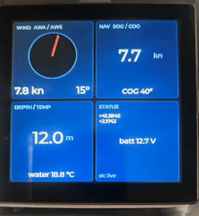
  </a>
  <br>
  <em>Live SignalK data — wind, navigation, depth, position, battery. Click for full-quality MP4.</em>
</p>

<p align="center">
  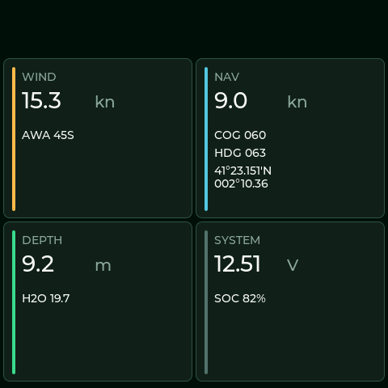
  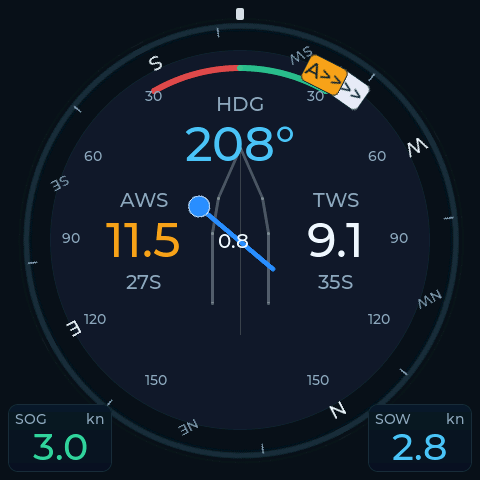
  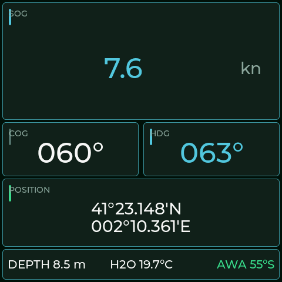
  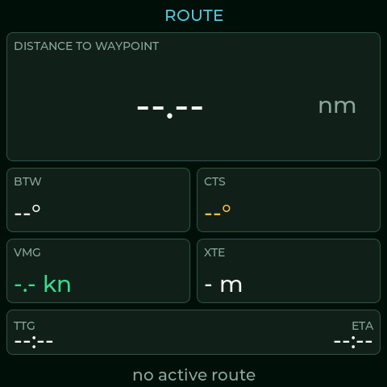
  <br>
  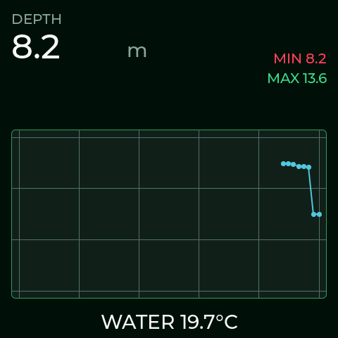
  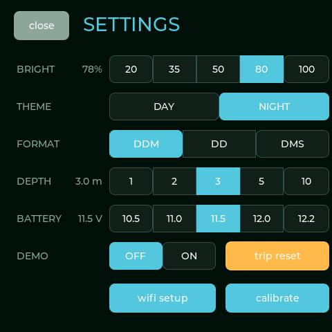
  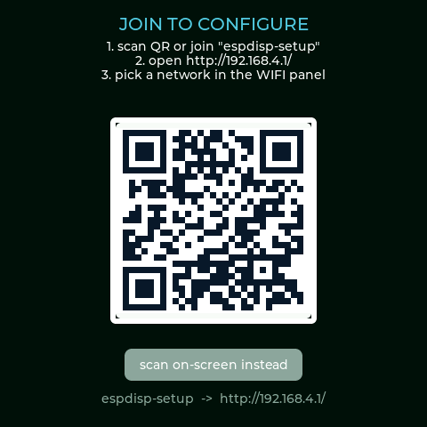
  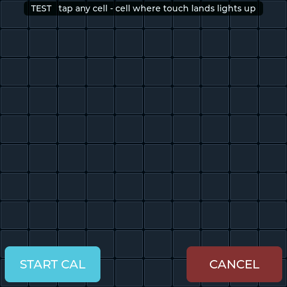
  <br>
  <em>Live screenshots captured from the device (glass-cockpit theme).</em>
</p>

> **Screens are MIDL documents.** Every content screen is a
> [MIDL](https://github.com/yey-boats/midl) record: the built-in screens
> (dashboard, wind, nav, depth, steering, route, autopilot, trip, status, ...;
> the knob's ap_hud / knob_compass / knob_wind / knob_big) are embedded in the
> firmware from `midl/library/builtin`, and Display Manager pushes (or the
> device pulls) further records. Settings, Wi-Fi setup and touch calibration
> stay native system UI. Contract: [docs/midl/midl-only.md](docs/midl/midl-only.md).
> See [docs/user-guide-signalk.md](docs/user-guide-signalk.md) for managing
> displays and OTA firmware from SignalK.

<p align="center">
  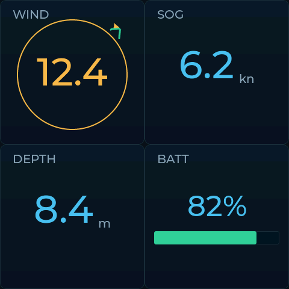
  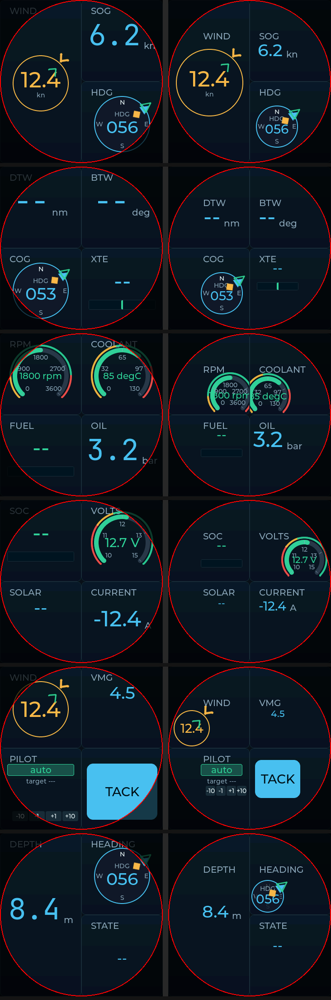
  <br>
  <em>MIDL screens rendered by the headless LVGL host harness (<code>make sim</code>,
  env <code>sim-midl</code>), which runs the real device render path
  (solver -> element mapping -> tile painters) and asserts no-overlap/in-bounds.</em>
</p>

## Features

- **SignalK over WebSocket** — subscribes to navigation, wind, depth, water temp, battery, tanks, route, and autopilot state
- **9 fullscreen screens** — Dashboard, Wind (compass rose + AWA/TWA arrows + tac sectors), Nav (huge SOG + DDM position), Depth (chart history + alarm bands), Steering (heading bug + CTS + XTE bar), Route (DTW/BTW/CTS/XTE/VMG/TTG/ETA), Autopilot (PUT to SignalK target/state), Trip (NVS-persisted distance/time/avg/max), System health
- **Swipe navigation** — horizontal swipes cycle screens; bottom swipe jumps to Dashboard
- **Day / night theme** — `theme day|night` console command, persisted in NVS
- **On-screen WiFi setup** — touch-keyboard SSID scan + password entry, no cable needed
- **MOB + alarms** — global overlays available from every screen
- **Touch diagnostics** — touch calibration/grid screens and GT911 interrupt/config-dump validation specs
- **Over-the-air updates** — ArduinoOTA on port 3232 (no USB cable for iteration)
- **BLE diagnostics + config** — Nordic UART service for logs + a structured Connection/Configuration GATT for companion apps
- **SignalK lab stack** — Dockerized SignalK server with official NMEA 0183 TCP and autopilot emulator plugins for repeatable testing
- **Control protocol (P2P)** — a versioned, schema-generated control protocol that lets a controller (knob, plugin, harness) discover and drive any display directly over IP (mDNS + `/api/p2p/*`, primary) and BLE (Control GATT, fallback), with lightweight many-to-many sessions and a per-controller colored frame on controlled displays — see [Control Protocol (P2P)](#control-protocol-p2p)
- **Experimental ESP display manager** — local SignalK plugin for device registry, provisioning, profiles, widget configs, command queues, firmware catalog/jobs, and a dashboard UI
- **Multi-target logging** — Serial / UDP broadcast / BLE notify, the same `logf()` writes to all three
- **Host-portable parser** — SignalK delta logic builds and tests on macOS / Linux as well as the device
- **CI + release automation** — GitHub Actions builds firmware and the SignalK plugin package on every push; tagged releases attach firmware binaries plus the matching plugin tarball

## Project status

This repository is suitable for lab testing and firmware/plugin development.
It is not yet a production navigation instrument.

| Area | Status |
|------|--------|
| ESP32 display firmware | Active; core screens, touch UI, WiFi, BLE, OTA, SignalK ingest, and diagnostics exist |
| SignalK local test stack | Active; `make demo-up` starts the configured SignalK container |
| NMEA 0183 over WiFi | Configured through the official `@signalk/signalk-to-nmea0183` plugin on TCP `10110` |
| Autopilot simulator | Configured through the official `@signalk/signalk-autopilot` emulator backend |
| ESP display manager plugin | Experimental but implemented and covered by local plugin tests |
| Firmware manager client | MVP implemented; opt-in contract tests exist; real-network validation and hardening remain |
| OTA fleet management | MVP implemented; plugin-side artifact/job model and firmware pull/apply path exist; hardware failure-path validation remains |

## Architecture Overview

The project has two cooperating halves:

- **ESP display firmware** runs on the touch panel. It renders the local UI,
  ingests SignalK/NMEA data, exposes diagnostics over serial/BLE/UDP, supports
  OTA, and includes a manager client that can register with SignalK, fetch a
  generated config, poll commands, report status, and run pull-based firmware
  updates.
- **SignalK lab and manager stack** runs on the development machine or boat
  server. It provides synthetic data, NMEA 0183 TCP output, an autopilot
  emulator, and the repo-owned `espdisp-manager` plugin for fleet-style display
  management.

The manager plugin is the control plane for configuring ESP display dashboards
from SignalK:

```text
SignalK server
  espdisp-manager plugin
    registry          known devices, status, display geometry, capabilities
    dashboard presets reusable screen/theme/widget configs for similar devices
    generated config  per-device dashboard merge of preset + overrides
    commands          reload dashboard config, screen actions, firmware actions
    firmware catalog  vendor/product/version metadata and OTA jobs

ESP display firmware
  register -> fetch config -> render -> heartbeat/status -> poll commands
```

Devices are not expected to receive arbitrary JSON from the operator UI.
Operators use structured pages:

- `Devices` lists registered panels, health, selected dashboard preset,
  display size, config drift, and pending commands.
- `Device config` edits a single dashboard from SignalK: preset assignment,
  day/night theme, brightness, NMEA WiFi source, autopilot widgets, widget font
  sizes, touch/debug mode, and per-device overrides.
- `Presets` manages reusable dashboard configurations so several panels of the
  same size or role can share a common setup. Presets can be imported/exported
  as JSON or YAML for review and version control.
- `Preset detail` applies one dashboard preset to selected devices and can
  queue `config.reload` so the devices pull the new generated dashboard config.
- Screens are MIDL records: Display Manager pushes them to the device
  (`PUT /api/midl/records/<id>`, `PUT /api/midl/index`) or the device pulls the
  `midl` block of its config (docs/midl/midl-only.md).
- `Firmware` tracks plugin-side firmware artifacts and OTA jobs; the firmware
  can pull, verify, install, reboot, and confirm jobs, with hardware
  failure-path validation still outstanding.

Current SignalK dashboard-configuration screenshots:

<p align="center">
  
  
  <br>
  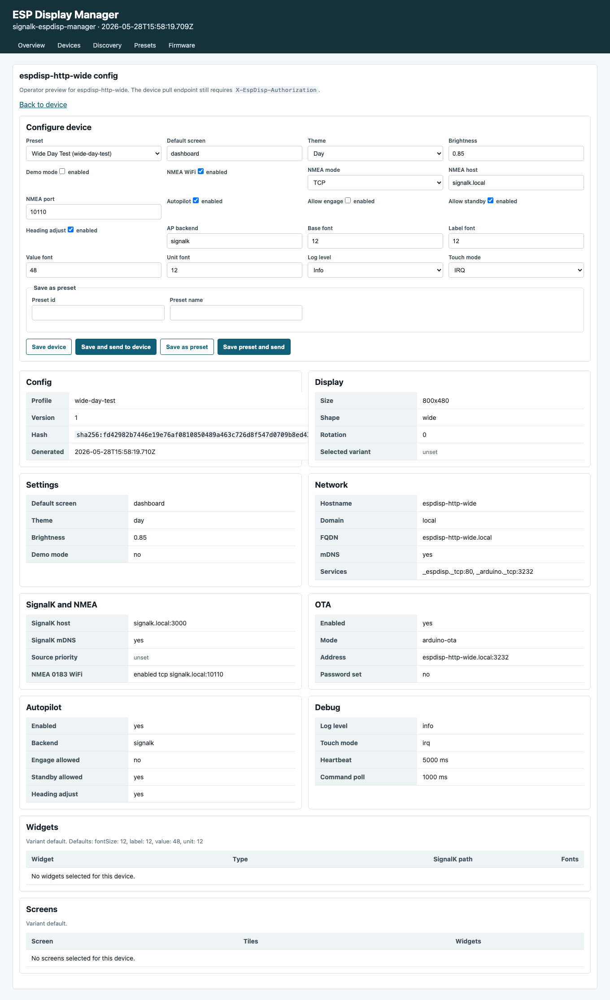
  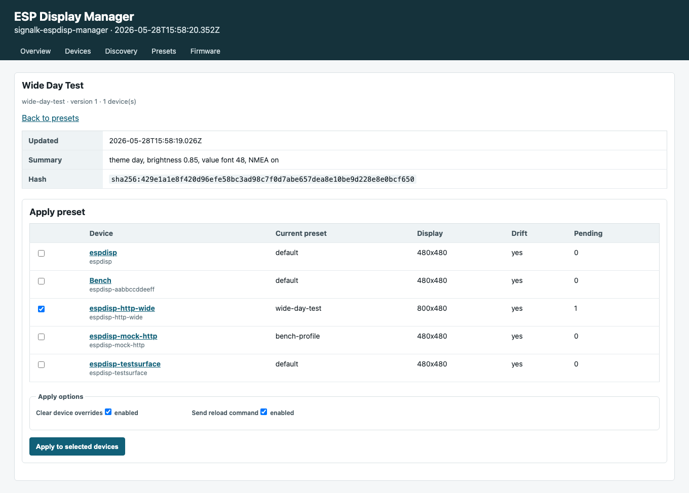
  <br>
  
  
</p>

## Hardware

Primary target:

| Component | Detail |
|-----------|--------|
| Board | Sunton / Guition **ESP32-4848S040** (also labelled `ESP32-4840S040`) |
| MCU | ESP32-S3-WROOM-1 **N16R8** — 16 MB flash + 8 MB octal PSRAM |
| Display | 4.0″ IPS 480×480, ST7701 RGB parallel |
| Touch | GT911 capacitive, I²C `SDA=19 SCL=45` |
| Storage | microSD slot |
| USB | USB-C with CH340 USB-UART |

Additional ESP32-S3 RGB touch profiles now compile through the same board
abstraction and report their geometry to the device identity/status APIs:

| PlatformIO env | Board profile | Display | Layout class |
|----------------|---------------|---------|--------------|
| `waveshare-touch-lcd-4` | Waveshare Touch LCD 4 | 480x480 square | `square-480` |
| `waveshare-touch-lcd-4_3` | Waveshare Touch LCD 4.3 | 800x480 landscape | `landscape-800x480` |
| `waveshare-touch-lcd-4_3b` | Waveshare Touch LCD 4.3B | 800x480 landscape | `landscape-800x480` |
| `waveshare-touch-lcd-5_800x480` | Waveshare Touch LCD 5 | 800x480 landscape | `landscape-800x480` |
| `waveshare-touch-lcd-5_1024x600` | Waveshare Touch LCD 5 | 1024x600 landscape | `landscape-1024x600` |
| `waveshare-touch-lcd-7_800x480` | Waveshare Touch LCD 7 | 800x480 landscape | `landscape-800x480` |
| `waveshare-touch-lcd-7b_1024x600` | Waveshare Touch LCD 7B | 1024x600 landscape | `landscape-1024x600` |
| `waveshare-knob-1_8` | Waveshare ESP32-S3-Knob 1.8 (rotary remote) | 360x360 **round** (ST77916 QSPI) | `square-compact` |

The `waveshare-knob-1_8` profile is a **rotary-encoder remote controller** with
a small set of dedicated round views rather than a full dashboard panel — see
[Remote Knob](#remote-knob) below and the
[deploy & use guide](docs/remote-knob.md).

These profiles share the current RGB/LVGL initialization path. They are build
profiles and geometry/layout contracts until each physical board passes the
hardware checklist for panel timing, backlight, touch coordinates, rotation,
CAN/RS485 exposure, SignalK connectivity, and dashboard rendering.

```sh
pio run -e waveshare-touch-lcd-4
pio run -e waveshare-touch-lcd-7b_1024x600
```

The firmware reports board metadata including resolution, shape, density,
layout class, usable area, display bus, touch controller, touch interrupt, and
NMEA 2000 CAN capability so the SignalK manager can select presets by geometry
instead of hardcoded board names.

## Remote Knob

The **Waveshare ESP32-S3-Knob-Touch-LCD-1.8** (`waveshare-knob-1_8`) runs the
same firmware as a **rotary remote controller**. It is a 360×360 **round**
ST77916 QSPI panel driven by a rotary encoder with a push button. Its screens
are the embedded round-360 MIDL records (`ap_hud`, `knob_compass`, `knob_wind`,
`knob_big`; home = the index `defaultScreen`); the rotary menu is native system
UI drawn over them. It can also drive **other** displays on the network through
the `espdisp-manager` plugin (switching their active view).

> Not yet verified on knob hardware since the MIDL-only change.

### Gesture cheat-sheet

| Level | Scroll | Click | Double-click | Long-press |
|-------|--------|-------|--------------|------------|
| **Home** (a MIDL screen) | next / previous screen | home screen | **Steer** | **Menu** |
| **Steer** (ap_hud + STEER badge) | AP target ±1° (hold: ±5°) | engage / standby | back to Home | Mode picker |
| **Menu** / pickers | move highlight | select / enter | back | — |

Scrolling in Steer while in Standby pre-sets the target so engaging Compass
holds it.

### Menu map

```text
Home  (MIDL carousel: scroll = next/prev, click = home screen)
  double-click -> Steer (shows ap_hud)
                    long-press -> Mode Picker (Standby / Compass / Wind / Route) -> Steer
  long-press   -> Menu
                    STEER    -> Steer
                    AP MODE  -> Mode Picker
                    DISPLAYS -> Select Display -> click a display -> Select View
                                                   click a view -> switch that display to it
                    CLOSE    -> Home
```

The display list = the knob itself (its four round views) plus the remote MFDs
discovered through the manager.

For flashing, provisioning, and using the knob to drive other displays, see
[Deploy & use the remote knob](docs/remote-knob.md).

## Control Protocol (P2P)

A **versioned, transport-agnostic control protocol** lets any controller (the
knob, the SignalK plugin, a future phone app) discover and drive any target
display **directly** — without routing through the SignalK manager. It is defined
once as a JSON Schema and code-generated into a C++ library (firmware) and a JS
library (`@espdisp/proto`, plugin), kept in lockstep by shared fixtures.

- **Discovery + control over IP (primary):** controllers browse `_espdisp._tcp`
  via mDNS and control targets over the versioned `GET/POST /api/p2p/*` HTTP/JSON
  surface (`device`, `attach`, `switch`, `heartbeat`, `detach`, `state`).
- **BLE (fallback):** targets expose an espdisp Control GATT service; controllers
  use an on-demand BLE central (scan → connect-one → control → disconnect) only
  when there is no reachable IP.
- **Sessions + colored frame:** lightweight many-to-many sessions (last-writer-wins,
  heartbeat/TTL reap); a controlled display renders a frame in each controlling
  controller's color with its name.
- **Verified on hardware** by the headless **ESP32-S3-DevKitC-1 harness**
  (`harness-s3-devkitc`), which loops discover → attach → switch → detach against
  a real display in place of the knob.

See the [espdisp Control Protocol guide](docs/control-protocol.md) for the message
types, endpoints, BLE UUIDs, the `ctl` config commands, and the harness procedure.

## Onboard setup

Normal boat installs should use firmware and plugin artifacts built by this
repository's GitHub Actions workflows, not ad-hoc local builds.

Stable release path:

1. Open the
   [latest GitHub release](https://github.com/yey-boats/instruments/releases).
2. Download the merged firmware image for the physical board, for example
   `esp32-4848s040-merged_firmware.bin` or
   `waveshare-touch-lcd-7b_1024x600-merged_firmware.bin`.
3. Download `signalk-espdisp-manager-<version>.tgz` for the SignalK plugin.
4. Verify artifacts with the release `SHA256SUMS` file.
5. Flash the display over USB:

```sh
esptool.py --chip esp32s3 --port /dev/cu.usbserial-* write_flash 0x0 <target>-merged_firmware.bin
```

6. Install the plugin on the boat SignalK server:

```sh
cd ~/.signalk
npm install /path/to/signalk-espdisp-manager-<version>.tgz
```

7. Restart SignalK, then enable **ESP Display Manager** in the SignalK admin
   plugin UI if you want centralized display management.
8. Provision the display onto the boat WiFi and SignalK server from serial or
   BLE:

```text
wifi <boat-ssid> <boat-wifi-password>
sk <signalk-host-or-ip> 3000
```

Latest CI artifact path:

- Firmware artifacts are attached to successful CI runs as
  `firmware-<platformio-env>-latest`, for example
  `firmware-esp32-4848s040-latest` or
  `firmware-waveshare-touch-lcd-7b_1024x600-latest`.
  Each artifact includes `merged_firmware.bin` for first USB flashing plus
  `firmware.bin`, `firmware.elf`, `bootloader.bin`, and `partitions.bin`.
- The plugin package artifact is named `signalk-espdisp-manager-<git-sha>`.
- CI artifacts are useful for testing current `main` or newer board profiles;
  releases remain the preferred stable boat install source.

For the full onboard checklist and network model, see
[Boat setup](docs/boat-setup.md). For development-only lab workflows, see
[Running with synthetic data](#running-with-synthetic-data) and
[Lab topology](docs/lab-topology.md).
For managed-display registry/config/command concepts, see
[SignalK ESP Display Manager](docs/signalk-espdisp-manager.md).
For the full status and upcoming work, see the [project roadmap](docs/roadmap.md).
For the full protocol/data-path reference (every NMEA2000 PGN, NMEA0183
sentence, and SignalK path the firmware understands), see
[Data coverage](docs/data-coverage.md).

## Development make targets

These targets are for development, testing, and local flashing.  Normal onboard
installs should start from the CI/release artifacts described above.

```
make help          List all targets
make setup         First-time setup (PlatformIO check + secrets.h)
make build         Build firmware
make test          Run host-side unit tests
make flash         Flash over USB (auto-detects /dev/cu.usbserial-*)
make ota              Flash over WiFi  (DEVICE_IP defaults to espdisp.local)
make monitor          Open serial monitor
make ble              Open BLE console (logs + commands without WiFi)
make logs             Listen for UDP log broadcasts on :9999
make demo-up          Start SignalK + synthetic data in local Docker
make demo-down        Stop the local demo stack
make demo-up-remote   Start SignalK on nav-server over SSH+Docker
make demo-down-remote Stop the remote stack
make sys-test-remote  Source .env.test and run system tests against the lab rig
make lint          Check formatting + Python syntax
make format        Auto-format C++ sources
make backup        Dump device flash to backup/full_flash_16MB.bin
make release-tag   Tag a release locally (VERSION=v0.1.0)
make clean         Remove build artifacts
```

## Versioning

Firmware versions are `MAJOR.MINOR.BUILD`:

- **MAJOR.MINOR** is the repo-configured source of truth, held in the
  `VERSION` file (committed as `MAJOR.MINOR.0`). `tools/check_version.py`
  verifies the patch component is `0` (it is CI-owned, never hand-edited).
- **BUILD** is `github.run_number` in CI (monotonic per repo), or `0` for
  local builds. CI stamps it via `YEYBOATS_VERSION=MAJOR.MINOR.<run_number>`.

PlatformIO runs `tools/version.py` before each build and injects:

- `FW_VERSION` from `YEYBOATS_VERSION` when set (CI / `make`), else a
  `MAJOR.MINOR.0+<commits>.g<sha>` dev string derived from `VERSION` + Git.
- `FW_GIT_COMMIT` from `GITHUB_SHA` or local Git.
- `PIO_ENV` from the active PlatformIO environment.

The firmware exposes those fields through device identity, mDNS discovery,
manager registration, `/api/state`, and OTA confirmation payloads.

Local version commands:

```sh
make version-check
make version-set VERSION=0.3      # set MAJOR.MINOR (BUILD stays CI-owned)
make build                        # stamps MAJOR.MINOR.0 locally
make build PROJECT_VERSION=0.3.99 # override the full version for a one-off
```

Release tags must share the `VERSION` file's MAJOR.MINOR, for example `v0.3.42`
when `VERSION` is `0.3.0`; the tag's BUILD is authoritative for the release. Tagged
GitHub releases build every supported firmware target, package the matching
`signalk-espdisp-manager-<version>.tgz` plugin, and publish checksums for all
release artifacts. Use those release assets for normal SignalK installs.

To install the SignalK plugin from the release asset or build a local package,
see the **yey-boats/Instruments-manager** repository (clone it next to this
repo as `../signalk-espdisp-manager`), which now owns the manager plugin and
its deployment.

## Console commands

Send these over the serial monitor (`make monitor`) or BLE (`make ble`):

| Command | Effect |
|---------|--------|
| `wifi <ssid> <pass>` | Save WiFi credentials and reboot |
| `wifi-forget` | Clear credentials, fall back to AP `espdisp-setup` |
| `ip` | Print current IP / mode / RSSI |
| `id` / `id <name>` / `id auto` | Show, set, or restore the hardware-derived device id |
| `scan` | List visible 2.4 GHz networks |
| `sk <host> [port]` | Save SignalK server target and reboot |
| `sk-status` | Print SignalK connection state + age of last delta |
| `sk-dump` | Print currently-parsed values of every tracked field |
| `screen <id\|next\|prev\|home\|N>` | Switch MIDL screens (built-in ids: dashboard wind wind_classic wind_steer nav depth steering route autopilot trip status; loads the owning record) |
| `theme <day\|night>` | Switch palette (saved to NVS) |
| `pos-format <ddm\|dd\|dms>` | Lat/lon formatting; ddm is marine default |
| `trip-reset` | Zero trip distance / time / max-speed |
| `mob` / `mob-clear` | Trigger / clear Man Overboard |
| `demo [N]` / `demo-off` | Auto-cycle screens every N seconds |
| `fps` / `bench` | Toggle FPS overlay / dump rendering stats |
| `reboot` | Soft restart |

## BLE access

The device advertises as `espdisp` with **two** GATT services:

### 1. Nordic UART (text console)

UUID `6E400001-B5A3-F393-E0A3-9F4DD9E3A05A` — line-oriented, same commands
as the serial console. Subscribe to TX `6E400003-…` for streamed logs;
write UTF-8 lines to RX `6E400002-…`.

```sh
make ble                       # sends `ip` + `sk-status`, then streams logs
make ble-cmd CMD="sk-status"   # one-shot command
```

### 2. boat-mfd config service (structured)

Service UUID `a3f7e000-7a6b-4f47-b3a5-c4d2e5f6a000` — intended for a
companion mobile app (task #26).

| Characteristic | UUID suffix | Props | Payload |
|---|---|---|---|
| **CONNECTION** | `…e001…` | Read · Write · Notify | JSON: `{ "wifi": {ssid, ip, rssi, mode}, "sk": {host, port, state}, "device": {uptime_ms, heap_free, psram_free} }` |
| **CONFIGURATION** | `…e003…` | Read · Notify | MIDL status summary: `{"midl":1,"record":"dashboard","screen":"dashboard","home":"dashboard","records":11}` |

Write to CONNECTION with a partial JSON to update WiFi or SignalK target:

```jsonc
{ "wifi": { "ssid": "MyHomeNet", "password": "secret" } }   // saves + reboots
{ "wifi": { "forget": true } }                              // clears creds + reboots
{ "sk": { "host": "192.168.1.100", "port": 3000 } }          // saves + reboots
```

Screens are MIDL records (up to 48 KB each), which do not fit a 512-byte GATT
attribute: they are pushed over HTTP (`PUT /api/midl/records/<id>`, see
[docs/midl/midl-only.md](docs/midl/midl-only.md)). CONFIGURATION only reports
the active record / screen.

## Running with synthetic data

> **Note:** The SignalK manager plugin and its deployment (the test server
> config, Docker compose, and `run.sh`/`run-remote.sh` scripts) now live in
> **yey-boats/Instruments-manager**. Clone it next to this repo as
> `../signalk-espdisp-manager` (or set `MANAGER_DIR`); the `make demo-*`
> targets below call its `deploy/scripts/`.

The local and remote demo stacks are for development and repeatable testing.
For a real boat network, use [Boat setup](docs/boat-setup.md) instead.

To exercise the firmware without a boat:

```sh
make demo-up
#   - starts signalk/signalk-server in Docker on :3000
#   - launch yey-boats-sim to push synthetic nav data (see docs/sim/kdcube-simulator.md)
make demo-down
```

`yey-boats-sim` (from `yey-boats/simulator`) connects to SignalK as an authenticated
provider and emits a full modelled dataset at 1 Hz — nav, wind, depth, autopilot,
AIS, current, and more.

### Development lab rig (remote SignalK + dedicated AP)

The remote lab workflow is intentionally separate from the onboard setup. It
uses a Docker-capable Linux mini-PC (`nav-server`) to run SignalK and broadcast
a dedicated `yey-net` AP for repeatable development tests. My lab host is a
[Compulab IOT-GATE-IMX8PLUS industrial ARM IoT gateway](https://www.compulab.com/products/iot-gateways/iot-gate-imx8plus-industrial-arm-iot-gateway/).

See [Lab topology](docs/lab-topology.md) for the full development diagram,
remote demo commands, `nav-server` setup, and Router/Starlink/etc. WAN-router
routing notes. Normal boat installs should use [Boat setup](docs/boat-setup.md).

### NMEA 0183 over WiFi

The demo SignalK server can also expose NMEA 0183 over WiFi using the official
SignalK plugin `@signalk/signalk-to-nmea0183`.

Configured service ports:

```text
SignalK HTTP/WebSocket: 3000/tcp
NMEA 0183 TCP:         10110/tcp
```

The plugin converts SignalK deltas to NMEA 0183 and publishes them through
SignalK's built-in `nmea-tcp` interface. In the local test server, the plugin
is configured with every supported conversion enabled at a 1000 ms minimum
interval; sentences only emit when their required SignalK paths have data.

Useful test:

```sh
nc localhost 10110
```

Expected demo output includes `GGA`, `RMC`, `HDT`, `MWV`, `VWR`, `VWT`, `DBT`,
and `MTW` when `yey-boats-sim` is pushing data.

If rebuilding the local SignalK container from scratch, install and enable:

```sh
make demo-up   # runs ../signalk-espdisp-manager/deploy/scripts/run.sh
```

The repo-owned config in the Instruments-manager repo (`deploy/config`)
installs and enables:

```text
@signalk/signalk-to-nmea0183
Server setting: interfaces.nmea-tcp = true
```

### Autopilot command simulator

SignalK can run an autopilot simulator using the official plugin
`@signalk/signalk-autopilot` with its `emulator` backend. This gives the
firmware a queryable endpoint for testing autopilot commands without a real
pilot on the network.

Install and enable it with the repo-owned SignalK test config:

```sh
make demo-up   # runs ../signalk-espdisp-manager/deploy/scripts/run.sh
```

The config in the Instruments-manager repo
(`deploy/config/plugin-config-data/autopilot.json`) enables:

```text
@signalk/signalk-autopilot
type: emulator
```

Useful query paths:

```text
/signalk/v1/api/vessels/self/steering/autopilot/state/value
/signalk/v1/api/vessels/self/steering/autopilot/target/headingMagnetic/value
```

Authenticated PUTs to `steering.autopilot.state` can be verified by reading
the state path back. The emulator also supports `actions.adjustHeading`; the
current firmware target-heading command uses `target.headingTrue`, which is
not the emulator's writable heading target.

## Screens: MIDL records

The display renders [MIDL](https://github.com/yey-boats/midl) screens only.
A **record** is one MIDL document (one or more screens) plus `{id, title,
source, hash}`; the device keeps embedded records (built from
`midl/library/builtin`, per display class) and the records Display Manager
pushes or the device pulls, on LittleFS. One record is active at a time;
swiping past its last screen loads the next record in the index order.

```sh
curl -u admin:<pw> http://<device>/api/midl/records          # list
curl -u admin:<pw> http://<device>/api/midl/records/wind     # one record
curl -u admin:<pw> -X PUT http://<device>/api/midl/records/mine \
     -d '{"title":"Mine","doc":{...}}'                       # store (source "local")
curl -u admin:<pw> -X POST http://<device>/api/midl/reset    # back to factory
```

Every write is validated against the device's own capability manifest
(`GET /api/midl/manifest`). The full device ↔ Display Manager contract (push,
pull, index, heartbeat) is in [docs/midl/midl-only.md](docs/midl/midl-only.md).

## Architecture

```
                 +-------------------+
                 |  ESP32-4848S040   |
                 |  ESP32-S3-N16R8   |
                 +---------+---------+
                           |
        +---- WiFi --------+--------- BLE --------+
        |                                         |
        v                                         v
 SignalK WebSocket                          Nordic UART
 ws://host:3000/                            (logs + commands)
 signalk/v1/stream
        |
        v
 +------+---------+
 | signalk_parser | -- applyDelta(json, Data) ----> sk::data
 +----------------+
        |
        v
 +----------------+     +-----------------------------+
 |   LVGL UI      | <-- | MIDL record store           |
 | MIDL screens   |     | embedded + pushed/pulled    |
 +----------------+     +-----------------------------+
   5 Hz refresh from boat data
```

| File | Purpose |
|------|---------|
| `src/main.cpp` | Display + touch init, LVGL UI, main loop |
| `src/midl_store.cpp` / `src/midl_store_ui.cpp` | MIDL record store, index, activation + navigation |
| `src/midl_render*.cpp`, `src/ui/ui_layouts.cpp` | MIDL element mapping + tile painters |
| `src/net.cpp` | WiFi STA/AP, ArduinoOTA, mDNS, BLE GATT, multi-target logging |
| `src/signalk.cpp` | WebSocket client, subscription, NVS-persisted target |
| `src/signalk_parser.cpp` | Pure delta parser (host-portable, unit tested) |
| `include/board_pins.h` | GPIO map for the supported board |
| `include/lv_conf.h` | LVGL build configuration |
| `include/secrets.h.example` | Template for WiFi/OTA credentials |
| `tools/ble_console.py` | BLE debug / config tool |
| `yey-boats-sim` | Full-blown boat simulator (separate repo `yey-boats/simulator`; see `docs/sim/kdcube-simulator.md`) |
| `tools/dump_chunked.sh` | Chunked, resumable full flash backup |

## Testing

```sh
make test
```

Unit tests live under `test/test_parser/` and run under PlatformIO's `native`
environment (Unity + ArduinoJson). The parser deliberately has no Arduino
dependencies, so the same code path that runs on the device is exercised on
the CI host. Tests cover every supported SignalK path, partial / malformed
payloads, and keep-alive frames.

## Releasing

Maintainers cut releases by tagging:

```sh
make release-tag VERSION=v0.1.0
git push origin v0.1.0
```

For tagged releases, GitHub builds with `YEYBOATS_VERSION=${TAG_NAME#v}` so
firmware version `0.3.42` corresponds to Git tag `v0.3.42` (the tag's BUILD is
authoritative; only its MAJOR.MINOR must match the `VERSION` file).

Every push to `main` also publishes a rolling **tip** prerelease (the `tip` job
in `ci.yml`): after the build matrix, host tests, and lint pass, it builds the
8 shippable targets, merges them, and force-updates a single GitHub release
tagged `tip` (named `tip (main @ <sha>)`, `prerelease: true`) with the merged
images + `SHA256SUMS`. The SignalK manager lists this as the TIP build
alongside the formal tagged RELEASES. It is an unstable, continuously-updated
build; use a `v*` tagged release for stable firmware.

The `release.yml` workflow builds all supported firmware targets from
`release-*` PlatformIO environments on push of a `v*` tag. These profiles keep
the same board IDs as development builds, but compile with
`YEYBOATS_RELEASE_BUILD=1`, `CORE_DEBUG_LEVEL=0`, and debug/test controls
disabled. The release publishes target-prefixed `firmware.bin`,
`merged_firmware.bin`, ELF, bootloader, partition table, plugin package, and
SHA-256 sums to the GitHub release, and generates release notes from commits
since the previous tag.

The merged image names are part of the SignalK firmware-catalog contract:
`esp32-4848s040-merged_firmware.bin`,
`waveshare-touch-lcd-4-merged_firmware.bin`, and the other supported target
names must be present alongside `SHA256SUMS` for the plugin to import
upgradable versions from GitHub.

Pre-releases are detected automatically: tags matching `*-rc*`, `*-alpha*`,
or `*-beta*` are marked as pre-release.

## Roadmap

- [ ] Triple-tap to expand a tile to fullscreen; triple-tap again to restore
- [ ] Swipe gestures to scroll between screens
- [ ] Advanced screens: compass rose, AIS targets, engine, anchor watch, tank levels, history graphs
- [ ] Raster chart display fed by a SignalK charts plugin
- [ ] NMEA 0183 input via RS-422 transceiver on a free UART
- [ ] Optional NMEA 2000 (CAN) support

## Related projects

| Project | Scope | License |
|---------|-------|---------|
| [`pypilot/pypilot_mfd`](https://github.com/pypilot/pypilot_mfd) | ESP32-S3 MFD: NMEA 0183 + SignalK + pypilot integration | GPLv3 |
| [`mxtommy/Kip`](https://github.com/mxtommy/Kip) | Web-based SignalK instrument package | — |
| [`mrstas/SC01_PLUS_MARINE_INSTRUMENTS`](https://github.com/mrstas/SC01_PLUS_MARINE_INSTRUMENTS) | SignalK instruments on Panlee SC01 Plus | GPLv3 |
| [`SignalK/SensESP`](https://github.com/SignalK/SensESP) | Sensor-side ESP32 framework (good companion) | Apache 2.0 |
| [`open-boat-projects-org/esp32-nmea2000-obp60`](https://github.com/open-boat-projects-org/esp32-nmea2000-obp60) | N2K gateway with OBP60 e-ink display | — |

## Contributing

Bug reports, board ports, and PRs welcome. See [CONTRIBUTING.md](CONTRIBUTING.md)
for development workflow and conventions. By contributing, you agree that
your contributions are licensed under PolyForm Noncommercial 1.0.0 (the
project license).

## Commercial use

This firmware is **not** licensed for commercial use under the default terms.
"Commercial use" includes selling the firmware, bundling it with hardware sold
for profit, integrating it into a paid service, or using it as part of a
commercial operation (e.g. charter fleets, paid installations).

For commercial licensing, contact **rights@yey.boats** (see [COMMERCIAL.md](COMMERCIAL.md)).

Noncommercial uses — personal boats, research, education, charitable and
governmental organizations — are explicitly permitted under the project
license.

## License

© 2026 Yey Boats Project. All rights reserved except as expressly licensed (see [NOTICE](NOTICE)).

[PolyForm Noncommercial 1.0.0](LICENSE) © 2026 Yey Boats Project.

This project bundles and links against the following libraries, each under
its own license:

| Library | License |
|---------|---------|
| LVGL | MIT |
| Arduino_GFX | MIT |
| NimBLE-Arduino | Apache 2.0 |
| WebSockets | LGPL-2.1 |
| ArduinoJson | MIT |
| Arduino-ESP32 | LGPL-2.1 |

These are unmodified upstream dependencies and remain governed by their
respective licenses.
